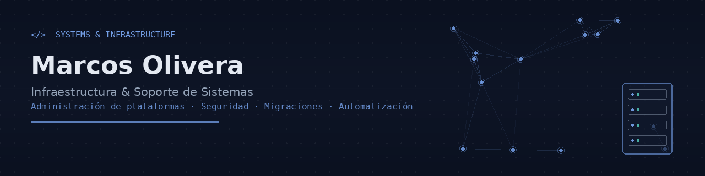

  

<h1 align="center">Analista de Sistemas - Soporte & Proyecto</h1>

  
  
  

## 📂 Contenido del portfolio

Este repositorio aloja mi portfolio profesional:

**🔗 [marcosadrianolivera.github.io/porfolio-marcos](https://github.com/OliveraMarcosAdrian/Porfolio.git)**

## 🧭 Perfil profesional

Profesional de sistemas e infraestructura con enfoque en la dirección de proyectos, la continuidad operativa y la entrega de soluciones tecnológicas alineadas con objetivos de negocio. 
Mi perfil combina la ejecución técnica con la gestión operativa y la comunicación efectiva con negocio y equipos. Entiendo tanto la complejidad del entorno tecnológico como la necesidad de entregar valor medible, con planificación clara, control de tiempos, alcance y riesgos.

- Liderazgo de proyectos de infraestructura, ERP y entornos críticos
- Gestión de riesgos, coordinación de equipos y stakeholders
- Definición de requerimientos y priorización de entregas
- Alineación entre negocio, operación y tecnología
- Mejora continua, automatización y optimización de procesos

### Competencias clave

- Planificación y seguimiento de proyectos
- Gobernanza de entornos productivos y no productivos
- Coordinación multi-equipo y stakeholders
- Gestión de incidencias y priorización
- Migraciones de gran escala y continuidad operativa
- Seguridad, roles, autorizaciones y control de acceso
- Documentación, reporting y toma de decisiones

## 🛠️ Stack técnico y herramientas

| Área | Tecnologías |
|---|---|
| Infraestructura | Linux, Unix, Windows Server |
| Bases de datos | HANA, SQL Server, MySQL |
| ERP / Sistemas | SAP ECC, S/4HANA, BTP, RISE |
| Lenguajes | Python, SQL, VB.NET / C#, Java, JavaScript |
| Gestión | Jira, Trello, Excel, reporting y seguimiento |
| Metodologías | Scrum, Kanban, gestión ágil y operativa |

## 🚀 Experiencia y valor entregado

- Administración y soporte de plataformas empresariales complejas
- Migraciones y cambios de entorno con enfoque en continuidad y seguridad
- Gestión de roles, autorizaciones y controles de acceso
- Coordinación con áreas técnicas y de negocio para priorizar y ejecutar entregas
- Traducción de necesidades del negocio en soluciones concretas y sostenibles

## 📬 Contacto

- ✉️ olivera.marcos@outlook.com
- 📍 Buenos Aires, Argentina

---

  © 2026 Marcos Olivera — Product Manager / Technical Project Manager | Infraestructura & Sistemas

